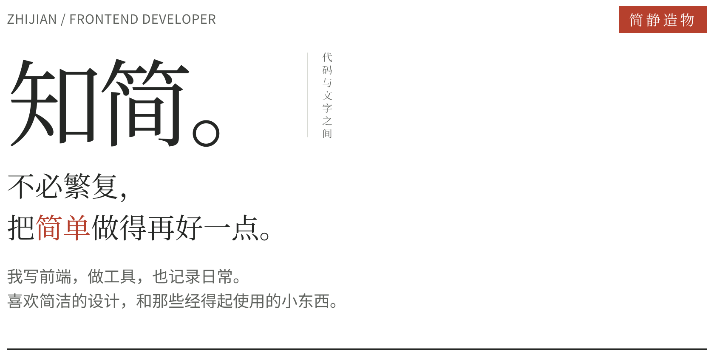

    

    在代码与文字之间，安静造物。 
    前端开发者 · 喜欢简洁设计 · 记录日常，也做一点有用的小东西

 

### 手边的作品

    01 &nbsp; <a href="https://github.com/zhijian521/mh-toolbox-rs">梦幻养老助手</a> &nbsp; Vue · Tauri · Rust 
    把角色养成、游戏收益和日常记账，收进一本本地手账。

    02 &nbsp; <a href="https://github.com/zhijian521/simple-blog">语无边 · Simple Blog</a> &nbsp; Astro · Markdown 
    一个极简的静态博客，留给笔记、项目和零散的想法。

    03 &nbsp; <a href="https://github.com/zhijian521/cesium-example">Cesium 三维地球</a> &nbsp; CesiumJS · WebGL 
    航线、空域、粒子与天气，在三维世界里做一些探索。

 

    <samp>TypeScript · Vue · Rust / Tauri · Astro · CesiumJS</samp>

---

    认真生活，简单做人，用心做事。 
    <a href="https://yuwb.dev">yuwb.dev ↗</a>

