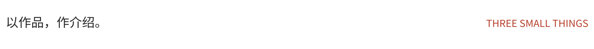
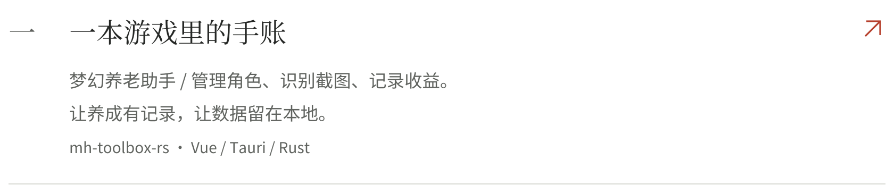
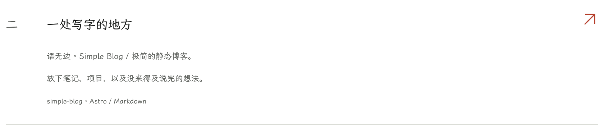
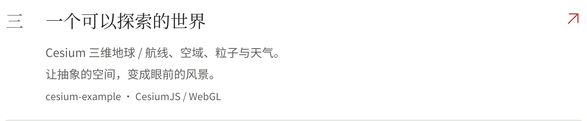
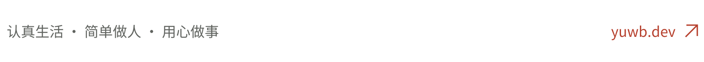

<picture>
    <source media="(prefers-color-scheme: dark) and (max-width: 600px)" srcset="./assets/banner-mobile-dark.svg">
    <source media="(max-width: 600px)" srcset="./assets/banner-mobile.svg">
    <source media="(prefers-color-scheme: dark)" srcset="./assets/banner-dark.svg">
    
</picture>

<picture>
    <source media="(prefers-color-scheme: dark) and (max-width: 600px)" srcset="./assets/works-title-mobile-dark.svg">
    <source media="(max-width: 600px)" srcset="./assets/works-title-mobile.svg">
    <source media="(prefers-color-scheme: dark)" srcset="./assets/works-title-dark.svg">
    
</picture>

<a href="https://github.com/zhijian521/mh-toolbox-rs">
<picture>
    <source media="(prefers-color-scheme: dark) and (max-width: 600px)" srcset="./assets/work-ledger-mobile-dark.svg">
    <source media="(max-width: 600px)" srcset="./assets/work-ledger-mobile.svg">
    <source media="(prefers-color-scheme: dark)" srcset="./assets/work-ledger-dark.svg">
    
</picture>
</a>

<a href="https://github.com/zhijian521/simple-blog">
<picture>
    <source media="(prefers-color-scheme: dark) and (max-width: 600px)" srcset="./assets/work-blog-mobile-dark.svg">
    <source media="(max-width: 600px)" srcset="./assets/work-blog-mobile.svg">
    <source media="(prefers-color-scheme: dark)" srcset="./assets/work-blog-dark.svg">
    
</picture>
</a>

<a href="https://github.com/zhijian521/cesium-example">
<picture>
    <source media="(prefers-color-scheme: dark) and (max-width: 600px)" srcset="./assets/work-earth-mobile-dark.svg">
    <source media="(max-width: 600px)" srcset="./assets/work-earth-mobile.svg">
    <source media="(prefers-color-scheme: dark)" srcset="./assets/work-earth-dark.svg">
    
</picture>
</a>

<a href="https://yuwb.dev">
<picture>
    <source media="(prefers-color-scheme: dark) and (max-width: 600px)" srcset="./assets/footer-mobile-dark.svg">
    <source media="(max-width: 600px)" srcset="./assets/footer-mobile.svg">
    <source media="(prefers-color-scheme: dark)" srcset="./assets/footer-dark.svg">
    
</picture>
</a>
